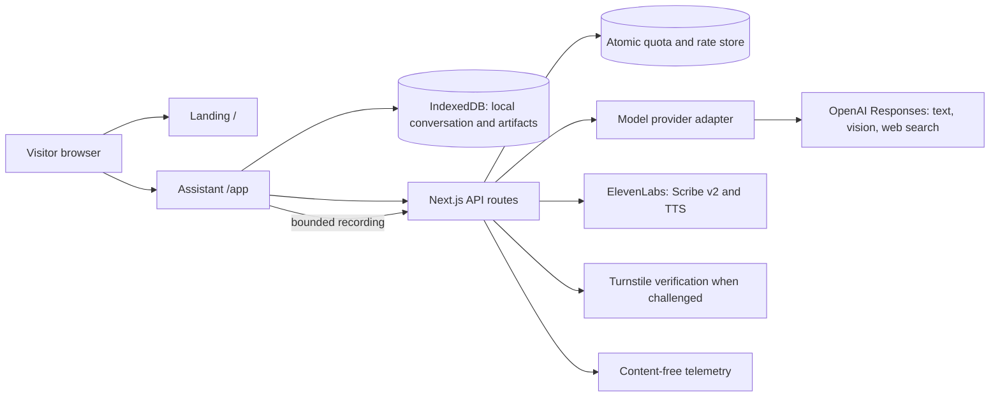

# GIGI — implementation plan

**Status:** build-ready plan · **Date:** 23 October 2026

**Companion:** [BRANDING.md](./BRANDING.md)

**Product shape:** two public routes (`/` landing, `/app` assistant), no account or login

**Priority:** excellent text and voice experience, then credible depth across vision, workspace, research, studio, coach, and lab

**Budget assumption:** low ongoing spend; public visitors can use a deliberately bounded demo

This plan turns the branding specification into an implementation sequence. It names a recommended stack, backend contracts, trust boundaries, cost controls, feature behavior, tests, and release gates. Exact model and hosting plans should be selected after a small benchmark with the owner's real API keys and target budget.

## 1. Outcome and scope

Build a portfolio-quality product that a stranger can open and use immediately. The landing page explains the idea; the app gives a real multimodal assistant experience. A visitor can type, speak, attach an image, choose a purposeful mode, inspect cited research, work with generated artifacts, and leave with an export. The UI stays coherent and honest about what is live, experimental, or temporarily unavailable.

### Non-negotiable constraints

- Exactly two user-facing pages. Advanced experiences live as panels or modes inside `/app`.
- No signup, password, social login, user account, or account database.
- Public access with server-side spending limits and abuse defenses. Anonymous access does **not** mean unlimited provider access.
- English and Filipino are first-class for UI, text, and voice. Validate code-switching with real samples before declaring voice support complete.
- ElevenLabs is the primary voice provider. The product should remain useful by text if voice is denied, exhausted, or unavailable.
- Preserve the [original cinematic design contract](./BRANDING.md); the orb is a functional state indicator with an accessible static fallback.
- No fabricated citations, pretend tool calls, fake provider results, or portfolio screenshots presented as live output.

### Release levels

| Level | User-visible scope | Reason |
| --- | --- | --- |
| **Foundation** | Landing, app shell, text streaming, local conversation, safety/cost controls | Creates a usable product and validates hosting economics. |
| **Public v1** | Press-to-talk ElevenLabs speech recognition and spoken replies; image question answering; sourced research; basic Workspace, Studio, Coach, Lab | Covers every priority area with honest, coherent workflows. |
| **v1.5** | Better exports, multiple image handling, guided research comparisons, artifact revision, voice interruption polish | Improves depth after real feedback. |
| **v2 experiment** | Natural full-duplex voice via ElevenLabs Speech Engine, richer media generation, optional share links | Requires separate cost and infrastructure decision. |

“Basic” in v1 means useful, not a dead-end tab. Each mode must complete at least one real end-to-end task and have a clear empty, success, and failure state.

## 2. Recommended architecture

### Stack decision

| Layer | Recommendation | Why / boundary |
| --- | --- | --- |
| Web app and API | **Next.js 16 App Router + React + TypeScript** | One deployable project, static/SEO-friendly landing, route handlers for streaming and provider proxy. Pin an exact supported version at build time. [Next.js Route Handlers](https://nextjs.org/docs/app/getting-started/route-handlers). |
| Styles | CSS custom properties from `BRANDING.md` + Tailwind CSS 4 if the team wants utility classes | Tokens remain the source of truth; avoid a generic component-kit look. |
| UI components | Accessible, semantic components; headless primitives only where needed (dialog, tabs, sheet) | Keep product visuals original. |
| Motion | CSS transitions and a restrained signal animation; the supplied WebGL2 Orb component for desktop interaction | Keep useful content visible while the orb initializes. Load the shader after interaction or page settle; use a static mobile/reduced-motion visual. Dispose GPU resources when unmounted. |
| AI orchestration | Server-side adapter around **OpenAI Responses API** initially | One provider for text, image understanding, and web research; keep an interface so the model/provider can change after evaluation. [Responses API docs](https://developers.openai.com/api/reference/resources/responses/methods/create). |
| Voice | **ElevenLabs Scribe v2** for bounded press-to-talk transcription and ElevenLabs TTS for speech output | Meets voice preference while preserving control over the assistant brain. The server validates and limits each uploaded recording; no provider secret reaches the browser. [ElevenLabs transcription API](https://elevenlabs.io/docs/api-reference/speech-to-text/convert). |
| Conversation/workspace | Browser IndexedDB, with explicit clear/export actions | No account or persistent server conversation database in v1. Local data is per-browser and can be lost when cleared. |
| Rate/budget state | Managed Redis-compatible store with atomic counters; start with one small instance | Shared limits work across serverless instances. No in-memory-only limiter in public production. |
| Deployment | Vercel for Next.js, with the rate store as a separate managed service | Simple deployment and previews. Verify function duration and streaming on chosen plan before launch. [Vercel limits](https://vercel.com/docs/functions/limitations). |
| Bot friction | Cloudflare Turnstile, invoked adaptively on expensive actions | Invisible/low-friction when possible; verify tokens server-side. [Turnstile validation](https://developers.cloudflare.com/turnstile/get-started/server-side-validation/). |
| Observability | Error monitoring plus structured, content-free logs and budget dashboard | Debug failures without logging visitor prompts, images, or audio. |

**Why not a database now?** Conversation and workspace data do not need cross-device sync because there are no accounts. A server DB would add retention, deletion, and access-control obligations with little v1 benefit. The managed rate store is operational state, not a conversation database. Add a persistent DB only for a future feature with a clear retention policy, such as opt-in public share links.

**Why press-to-talk first?** It gives a clear permission and cost boundary, supports transcripts, and runs within an ordinary browser plus server route architecture. ElevenLabs’ bring-your-own-LLM Speech Engine uses a persistent upstream WebSocket server, so full-duplex conversation would need an additional long-running service and a separate spend/latency evaluation. [Speech Engine architecture](https://elevenlabs.io/docs/overview/capabilities/speech-engine/).

### System map



For voice, the browser records up to 30 seconds after permission, then uploads the bounded file to `/api/voice/transcribe`. The transcript enters the same `/api/chat/stream` pipeline as typed text. TTS bytes return via the server proxy; the browser controls playback. All provider keys stay on the server.

### Repository shape

```text
src/
  app/
    page.tsx                 # landing
    app/page.tsx             # assistant
    api/
      capabilities/route.ts
      chat/stream/route.ts
      voice/transcribe/route.ts
      voice/speak/route.ts
      limits/route.ts
  features/
    landing/
    conversation/
    voice/
    vision/
    research/
    workspace/
    studio/
    coach/
    lab/
  components/
    ui/                     # shared accessible primitives
    orb/
  server/
    ai/                     # provider adapter, prompts, tool policy
    voice/                  # ElevenLabs adapter
    limits/                 # quotas, spend reservations, Turnstile
    http/                   # validation, typed errors, event helpers
    observability/
  shared/
    contracts/              # runtime schemas + TypeScript types
    i18n/
    design-tokens/
tests/
  integration/
  e2e/
  evals/
public/
  orb-poster.webp
```

Keep HTTP handlers thin: validate → admit/limit → call service → map result/error → settle usage. Prompts and provider calls live in server modules. Presentation components never call a provider directly.

## 3. Frontend plan

### Landing `/`

Implement the sequence in `BRANDING.md`: compact header, typography-led hero, original GIGI orb, outcome proof, seven-capability editorial chapter, real product sample, trust/limits, final CTA. Render headline and CTA in HTML before loading 3D. The primary action goes to `/app`; capability links open `/app` with a safe mode query parameter, such as `/app?mode=research`, with server/client validation against an allowlist.

The landing should use at most a few coordinated reveals. Use responsive art direction: large orb beside headline on wide screens, then below/behind a bounded region on small screens. Static poster remains attractive with JavaScript off or reduced motion. SEO metadata, social preview, sitemap/robots, and structured page title/descriptions are part of the landing implementation, but no fabricated reviews or product claims.

### Assistant `/app`

Build a stable three-region desktop layout: compact mode navigation, transcript/work area, optional context panel. Collapse to a one-column mobile layout with bottom sheet for modes and detail. The composer remains accessible above the virtual keyboard. There is one conversation model shared by text, voice, and image; a mode changes the task policy and result presentation, not the whole application shell.

**Core component set:** app header, mode picker, starter prompt list, composer, attachment preview, transcript turn, response renderer, source list, artifact card, workspace drawer, orb/status, voice controls, quota notice, permission panel, error banner, details sheet, language control, export/clear controls.

**State model:** separate (1) durable local conversation/artifacts, (2) ephemeral UI state, (3) server request state, and (4) voice hardware/provider state. Use a reducer or small state machine for voice (`idle`, `permission`, `listening`, `committing`, `thinking`, `speaking`, `stopped`, `error`) so the orb, labels, buttons, and cleanup agree. Use URL only for shareable non-sensitive state such as selected mode, never prompts or private content.

**Local persistence:** IndexedDB stores conversation turns, artifact metadata/content, user-selected language, reduced-motion preference, and optional draft. Provide a “Save this session on this device” toggle if persistence is not automatic. The app says clearly that local history does not sync. Clear conversation deletes the relevant records and preview blobs. Export Markdown/JSON locally, including source URLs and a timestamp; imports are a later feature.

**Streaming UX:** show tokens in a stable answer container, support Stop, and keep the scroll position when a visitor reads earlier turns. Announce only final/meaningful status to assistive tech. On network interruption, mark the answer incomplete and offer Retry. Do not replay a POST automatically after uncertainty without an idempotency key.

**The orb:** the supplied WebGL2 shader component, with a static CSS fallback, capped pixel ratio, paused render when hidden/offscreen, disposed GPU resources on route transition, and no text over the shader. Hook its visual state to the same voice state machine as the labels. Respect reduced motion. `BRANDING.md` defines the state-to-visual mapping.

### Mode behaviors for v1

| Mode | One complete user job | UI output | Backend rule |
| --- | --- | --- | --- |
| **Voice** | Ask aloud, view transcript, hear a spoken answer | Transcript, listening status, audio control | Voice is input/output around chat; TTS never plays automatically without the visitor initiating voice. |
| **Vision** | Attach one image and ask a question | Preview, concise visual answer, uncertainty | Validate MIME/size, process in memory, never accept arbitrary remote image URLs from visitor. |
| **Workspace** | Pin a useful answer or draft and export it | Local item list, rename/remove/export | No server sync claim. |
| **Research** | Ask a current question and inspect cited sources | Answer with inline citations and source panel | Force actual web search when selected; expose source annotations. |
| **Studio** | Draft, rewrite, or transform a piece of text | Editable artifact with revision action | First release is text-based creation. Image/audio generation is separately gated by budget. |
| **Coach** | Set a goal and receive a step-by-step practice plan | Goal, current step, actionable feedback | Keep advice bounded and transparent; no professional diagnosis claims. |
| **Lab** | Compare two curated prompt approaches on the same input | Side-by-side result and explanation | Strictly curated experiments, low token ceiling, no raw API/model settings or arbitrary tool execution. |

The selected mode is visible on every request. The server chooses the actual prompt, tool access, model tier, and budget; it does not trust a client-supplied system prompt or price tier. A visitor may switch modes without losing the conversation, but the UI should explain when the new mode ignores an incompatible attachment.

## 4. Backend and API plan

### Contracts

Use runtime schemas (for example Zod) shared between client and server. Version the app-level event/payload schema even if the URLs do not initially include `/v1`. All endpoints reject oversized or unexpected fields; give typed error codes and safe messages. API routes use the Node.js runtime where provider SDKs and streaming support require it.

| Endpoint | Purpose | Request | Response / failure |
| --- | --- | --- | --- |
| `GET /api/capabilities` | Truthful feature and limit map | None | Enabled modes, supported attachment types, current voice availability, language list, public limits. Never send secrets or private quota internals. |
| `POST /api/chat/stream` | Text, vision, research, studio, coach, lab answer | `requestId`, `mode`, recent bounded turns, user text, optional validated image payload/reference, locale | Streaming events: `start`, `status`, `text_delta`, `citation`, `artifact`, `usage`, `done`, `error`. Abort on disconnect. |
| `POST /api/voice/transcribe` | Transcribe one bounded recording | Audio file and Turnstile token if challenged | Transcript text; 413/429/503 on size, quota, or provider failure. |
| `POST /api/voice/speak` | Convert one bounded assistant answer to speech | `requestId`, approved voice ID, language, text or server-issued answer reference | Stream audio bytes; reject arbitrary very long text and unapproved voice IDs. |
| `GET /api/limits` | Explain remaining public-demo allowance | Anonymous signed session cookie | Approximate remaining usage or “available/limited/exhausted”; no promise of a precise identity. |

**Streaming transport:** use a streamed `fetch()` POST response with a documented event framing format (SSE-style or newline-delimited JSON), because `EventSource` only opens GET requests. A `requestId` makes retries traceable and helps reject duplicate billing. Send a heartbeat for long operations and a final `done` or typed `error` event. Test proxy buffering and abort behavior in the actual deployment environment.

**Input ceilings, configurable:** initial design limits are 12,000 characters of new text, the newest 8 conversation turns after server-side trimming/summarization, one image up to 5 MB after client resizing, 30 seconds of speech per turn, and a short TTS answer cap. These are policy defaults to validate against provider limits and measured cost, not hard promises to users. Reject disallowed MIME and magic bytes, not just file extension; strip metadata where feasible. Consider image dimensions and decompression size before processing.

**Model adapter:** define `generate({mode, messages, image?, locale, signal}) -> event stream`. The adapter owns model IDs, reasoning/tool settings, token caps, provider timeouts, retries for safe transient failures, and citation parsing. Keep a low-cost default model and allow a stronger model only for tasks where evaluation proves a benefit. Model selection is server-side config, never a public toggle in v1. Use `store: false` for Responses requests when the desired policy is no provider-side response state, and explicitly document that this is not the same as a zero-retention contract. [OpenAI conversation-state docs](https://developers.openai.com/api/docs/guides/conversation-state) and [data controls](https://developers.openai.com/api/docs/guides/your-data).

**Research:** use the current Responses `web_search` tool when Research mode is selected. Preserve source titles/URLs and position annotations from the provider response. Render citations as clickable links adjacent to claims. If search fails, state that no live research was performed and offer a general answer only with clear labeling. [OpenAI web search guidance](https://developers.openai.com/api/docs/guides/tools-web-search).

**Vision:** pass validated image input to the vision-capable model via the server; do not fetch arbitrary URLs supplied by visitors, which could expose internal networks. Treat image text and embedded instructions as untrusted content. Ask clarifying questions when the image is ambiguous. Do not claim OCR-perfect transcription.

**Voice:** Browser microphone capture starts only after an explicit action and permission. The Stop button ends recording, then uploads a size-bounded file through the server to Scribe v2; the transcript enters the normal chat endpoint. This avoids handing an anonymous browser a long-lived real-time connection token. For output, generate bounded TTS through the server and stream audio to the browser; support immediate Stop and no background autoplay. ElevenLabs lists Filipino for Scribe v2 and Eleven v4, but test real Filipino and English/Filipino code-switching with the chosen voice/model before launch. [ElevenLabs STT language list](https://elevenlabs.io/docs/overview/capabilities/speech-to-text) and [TTS model languages](https://elevenlabs.io/docs/overview/models).

### Anonymous access and abuse control

No authentication is required. Use a signed, HttpOnly, SameSite=Lax anonymous session cookie **only** to track coarse public-demo quotas. It is not an identity, and clearing cookies can reset it; combine it with privacy-conscious network-based limits, global caps, and provider account limits. Never use client-only counters as the protection boundary.

Admission order for every billable route:

1. Validate origin/host, method, content type, schema, and size. Configure CORS for this site only.
2. Determine coarse anonymous bucket (signed cookie plus salted/rotated IP-derived bucket); avoid storing a plain IP longer than necessary.
3. Apply per-minute requests, concurrent requests, voice minutes, and daily spend limits via atomic store operations.
4. Challenge suspicious/high-cost traffic with Turnstile; verify the token on the server. A browser-only challenge is ineffective.
5. Reserve an estimated maximum cost before calling providers. Reject with 429/`Retry-After` when exhausted.
6. Enforce upstream timeouts, max output, and cancellation. Reconcile actual usage after completion; release unused reservation on safe failure.
7. Record counts and cost estimates without prompt/audio/image content. Alert on unusual spikes; have a manual kill switch per feature/provider.

Set one **global daily monetary ceiling** across AI, web search, STT, and TTS, then smaller per-session ceilings. Price tables change, so configure rates rather than hard-code them in UX. Review actual provider billing against the ledger weekly. Web search has an additional per-call cost plus model input costs, so do not enable it for every ordinary chat. [OpenAI pricing](https://developers.openai.com/api/docs/pricing).

### Safety, privacy, and reliability

- Keep all long-lived API keys in server environment variables; restrict and rotate them. Never embed keys in the client bundle, source control, error payload, or logs.
- Treat prompts, retrieved pages, transcripts, and image text as untrusted. Tools are allowlisted by mode; never execute arbitrary URLs, shell commands, or user-supplied code on the server.
- Render assistant Markdown through a safe parser; sanitize HTML, disable raw HTML, and constrain external links. Apply a Content Security Policy that accommodates only necessary scripts/media/WebSocket destinations.
- Apply provider/content policy to both input and output as appropriate to a public demo. Make refusal messages useful and non-accusatory.
- Use server timeouts and `AbortSignal` for provider calls; stop work when the client disconnects. Do not blindly retry streamed generation or TTS because that can double spend.
- Log request ID, endpoint, mode, duration, provider status, token/voice usage totals, and error code. Exclude message text, image bytes, audio, and source snippets. Define a short retention period for operational logs.
- Show a clear privacy notice: browser-local history behavior, which third parties process text/audio/images, whether audio is retained, and how to clear local data. Review provider terms/data controls before publishing.
- If Redis/budget store fails, billable endpoints fail closed with a friendly explanation; the landing and locally stored workspace still work.

## 5. Cost plan and external accounts

### Accounts and keys the owner will need

| Need | Required when | Credential / configuration |
| --- | --- | --- |
| AI provider project | Foundation | API key, billing cap, permitted model(s), Responses/web-search access. |
| ElevenLabs | Voice milestone | API key, approved voice ID(s), Scribe access, TTS model/format, provider quota. |
| Hosting | First deployed preview | Vercel project and environment variables; domain later. |
| Atomic rate store | Before public launch | Managed Redis-compatible URL/token with TTL and atomic increment/transaction support. |
| Turnstile | Before public launch | Public site key + private secret, configured allowed hostnames. |
| Error monitoring | Before public launch | Project key/DSN with content scrubbing configured. |
| Domain | Public launch | DNS and HTTPS configuration. |

Optional later: object storage for shareable artifacts; a long-running WebSocket host for Speech Engine; image/audio generation provider permissions. The owner should **not** put keys in chat, `BRANDING.md`, or committed `.env` files. Add an `.env.example` with variable names only.

### Budget worksheet

Before implementation, set a target monthly budget `B` and maximum daily spend `D`; configure the public gate so `D` is enforceable even during a traffic spike. Estimate:

```text
monthly cost ≈ model input/output tokens
             + research tool calls and retrieved-context tokens
             + Scribe audio seconds
             + TTS characters/audio generation
             + hosting bandwidth/function time
             + rate-store and monitoring charges
```

Run a 20–50 task benchmark in English and Filipino to measure median and high-percentile cost, latency, quality, and voice minutes. Use those values to set quotas. Suggested initial public limits are intentionally small: a few chat turns per anonymous session per day, shorter voice turns, and fewer Research/Lab uses. Publish the limits plainly in the UI. Tighten or raise them from measured traffic; do not promise an unlimited free assistant.

## 6. Build phases and exit gates

| Phase | Work | Exit gate |
| --- | --- | --- |
| **0. Contract and prototype** | Confirm budget `B`, key availability, content/privacy decisions, final or placeholder name; sketch landing/app at 320/768/1440 px; prove streaming route, bounded Scribe upload, TTS, and one image call in isolated spikes. | Provider capabilities and hosting constraints confirmed; representative English/Filipino samples pass a human review. |
| **1. Design foundation** | Create tokens, fonts, primitives, responsive shell, static orb poster, landing content and CTA; accessibility skeleton and SEO. | Both routes load directly; landing communicates product without JS/3D; no horizontal overflow. |
| **2. Text and backend foundation** | Typed contracts, chat stream, model adapter, error taxonomy, abort/idempotency, local conversation, quotas, Turnstile hook, logging/monitoring. | End-to-end text chat works with real provider; budget gate can block before spending; failure state preserves draft. |
| **3. Priority multimodal** | Vision upload, Research citations, voice STT/TTS flow, permission UX, orb state wiring. | Text, image, and voice paths work in both languages at defined acceptance quality; no key exposure or autoplay. |
| **4. Depth modes** | Workspace pin/export; Studio draft/revise; Coach plan/step feedback; Lab curated comparison; consistent mode surfaces. | Each of seven priority areas has one completed real user job, not a placeholder tab. |
| **5. Finish and launch** | Visual polish, 3D enhancement, reduced motion, mobile keyboard, content pass, tests/evals, security/privacy review, cost load test, deployment. | All launch checks in §8 pass; owner can disable a provider without redeploying if possible. |
| **6. Post-launch** | Read content-free telemetry, fix friction and failures, recalibrate quotas, review costs, then decide on full-duplex voice or media generation. | Changes follow observed demand and a renewed budget decision. |

Do not build the 3D orb before the text pipeline and static layout are usable. Its quality bar is high, but it is not on the critical path for a working assistant.

## 7. Verification plan

### Automated checks that carry real value

- Typecheck, lint, build, and dependency/license checks on every pull request.
- Unit tests for request schema validation, mode/tool allowlist, quota reservations/settlement, event parser, citation mapping, and voice state transitions.
- Integration tests with provider adapters mocked for streaming success, disconnect, timeout, malformed provider response, rate limit, Turnstile failure, and budget-store outage.
- Browser tests for landing CTA; text message; Stop; image attach/remove; research source link; voice permission denied; clear/export local history; mobile mode sheet. Run at 320, 768, and 1440 px.
- Accessibility checks with automated tooling **and** manual keyboard/screen-reader inspection. Validate focus after dialogs, live-region verbosity, color contrast, 200% zoom, reduced motion, and no-WebGL fallback.
- Visual snapshots for both routes and key states; evaluate against the original brand system rather than a generic template.
- Security tests for oversized/mislabelled files, forged session cookie, quota race, replayed request ID, cross-origin requests, unsafe Markdown, and prompt injection in retrieved/image content.

### Human evaluation set

Maintain a versioned set of at least 30 representative prompts/assets: casual chat; factual question; current research requiring citation; conflicting sources; image with small text; ambiguous image; Studio revision; Coach follow-up; Lab comparison; English, Filipino, and mixed-language voice; quiet/noisy audio; prompt injection in a webpage/image; and incomplete/unsupported requests. Score correctness, citation quality, language fit, refusal behavior, latency, and cost. Do not ship a model change solely because a few demo prompts look impressive.

### Nonfunctional launch targets

- Target WCAG 2.2 AA and document any exception before launch. Follow the 44 px touch-target design rule in `BRANDING.md`.
- Aim for Core Web Vitals at the 75th percentile: LCP ≤ 2.5 s, INP ≤ 200 ms, CLS ≤ 0.1; assess mobile and desktop separately. [web.dev thresholds](https://web.dev/articles/vitals/).
- Define measured time-to-first-text, time-to-first-audio, and total-answer targets after the phase-0 benchmark; avoid inventing fixed promises before provider/network testing.
- Under simulated concurrent public traffic, global spend never exceeds configured cap beyond the bounded in-flight reservation margin.
- Provider outage, denied permissions, WebGL failure, and quota exhaustion preserve a clear text-based path where feasible.

## 8. Public launch checklist

- [ ] The two routes, metadata, responsive layouts, and direct navigation work in production.
- [ ] All enabled features call real services; disabled/experimental features are labeled truthfully.
- [ ] No long-lived API secret appears in browser bundles, network responses, source maps, logs, or repository history.
- [ ] Anonymous per-session, per-network, concurrency, and global spend gates are exercised; the kill switch works.
- [ ] Turnstile tokens are verified server-side when a challenge is required.
- [ ] Research citations are clickable, correctly mapped to claims, and absent when no actual source was retrieved.
- [ ] Voice requires an explicit gesture; Stop fully ends capture/playback; permission denial leaves text chat usable.
- [ ] English, Filipino, and mixed-language flows pass human voice/content review with the exact models and voices to be deployed.
- [ ] Images are validated, size-bounded, and not retained on the server beyond processing; privacy copy matches actual behavior.
- [ ] Browser-local history, clear, and export behave as described.
- [ ] Static orb, reduced-motion, keyboard, screen-reader, mobile keyboard, and 320 px reflow checks pass.
- [ ] Monitoring and cost alerts are live; provider failure and rate-limit messages are understandable.
- [ ] Owner has reviewed the production URL, final copy, sample labels, legal/privacy links, and monthly spend ceiling.

## 9. Decisions still needed from the owner

These do not block the architecture document; use the defaults until the owner decides:

1. **Monthly provider budget `B`:** choose the actual currency amount before public launch. Default implementation assumes a strict low cap and graceful exhaustion.
2. **Domain:** `GIGI` is the selected product name; choose a canonical domain before launch.
3. **Default voice:** select an ElevenLabs voice after English/Filipino listening tests and confirm its usage rights.
4. **Privacy posture:** default to browser-local workspace, `store: false` model calls, no raw-content logging, and short operational-log retention; publish exact wording after reviewing provider policies.
5. **Portfolio visibility:** decide whether Lab and advanced generation appear publicly at launch or after the first traffic/cost review. The plan keeps at least one bounded Lab experiment in v1.

## 10. Source and currency notes

Documentation checked on 23 October 2026: [Next.js streaming](https://nextjs.org/docs/app/api-reference/file-conventions/route), [OpenAI Responses](https://developers.openai.com/api/reference/resources/responses/methods/create), [OpenAI web search](https://developers.openai.com/api/docs/guides/tools-web-search), [OpenAI data controls](https://developers.openai.com/api/docs/guides/your-data), [ElevenLabs Scribe transcription](https://elevenlabs.io/docs/api-reference/speech-to-text/convert), [ElevenLabs Speech Engine](https://elevenlabs.io/docs/overview/capabilities/speech-engine/), [ElevenLabs language support](https://elevenlabs.io/docs/overview/capabilities/speech-to-text), [Vercel function limits](https://vercel.com/docs/functions/limitations), [Cloudflare Turnstile validation](https://developers.cloudflare.com/turnstile/get-started/server-side-validation/), [W3C WCAG 2.2](https://www.w3.org/TR/WCAG22/), and [web.dev Core Web Vitals](https://web.dev/articles/vitals/). Recheck provider limits, versions, pricing, and model IDs immediately before deployment.
